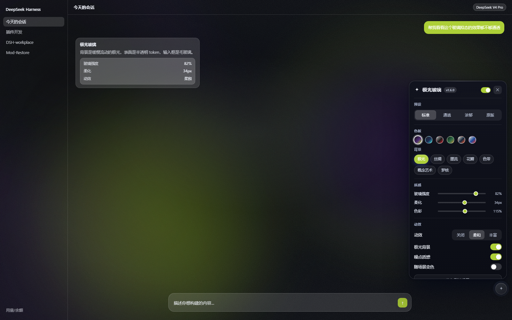
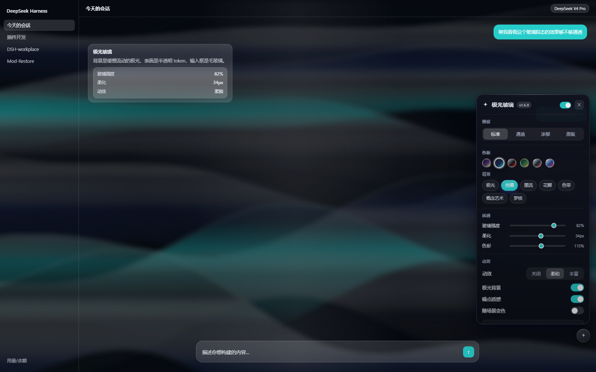
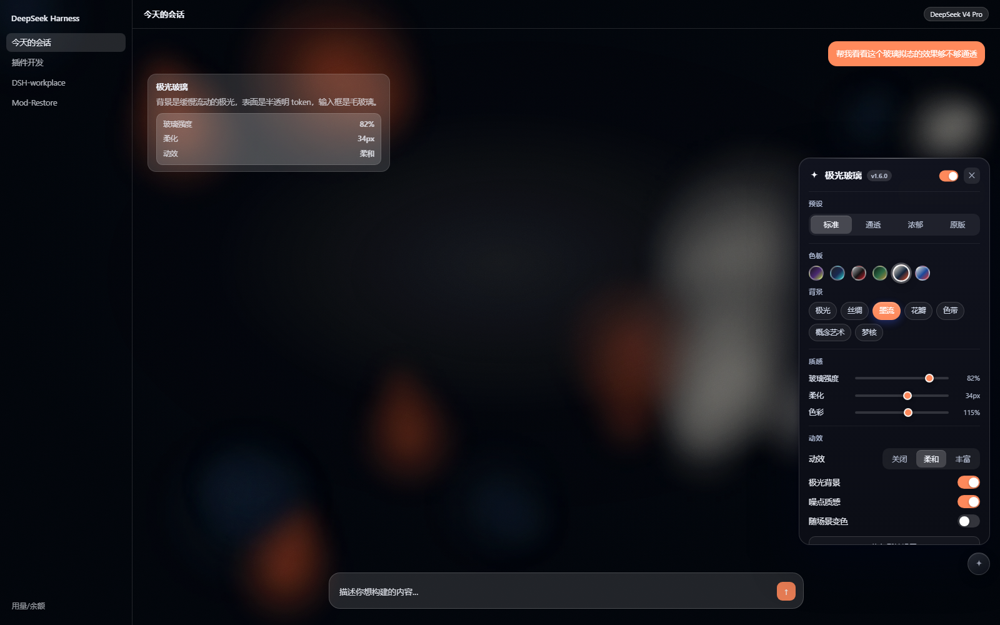
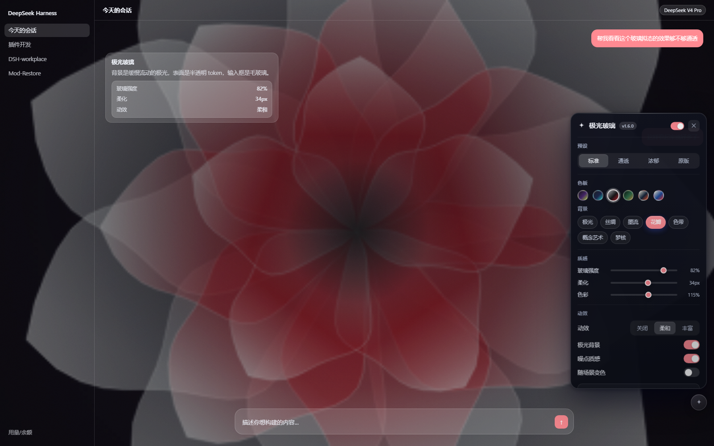
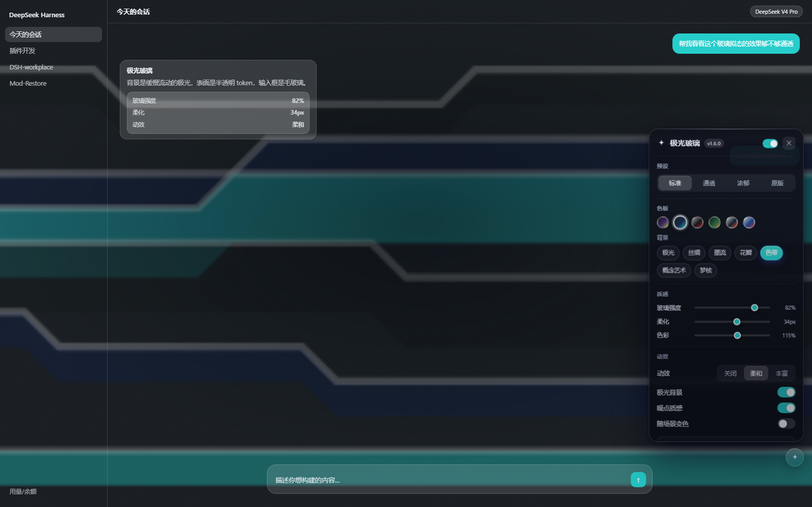
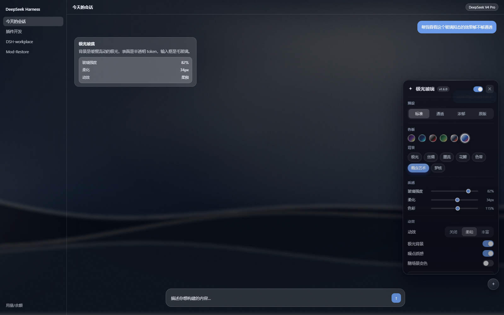
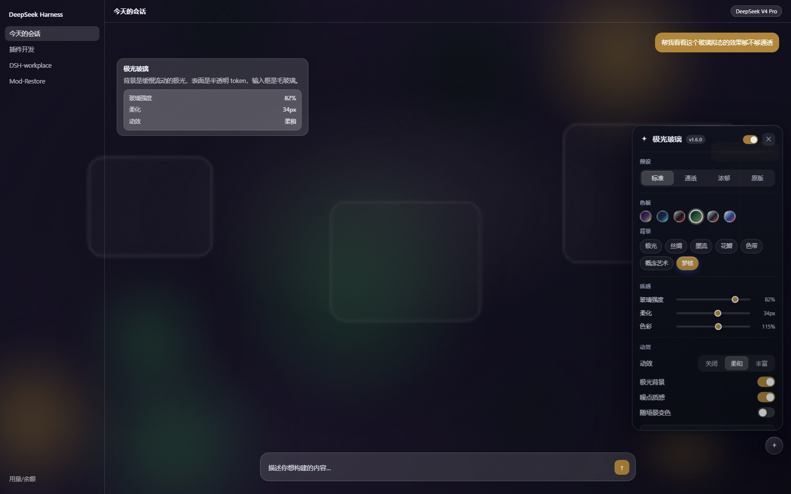
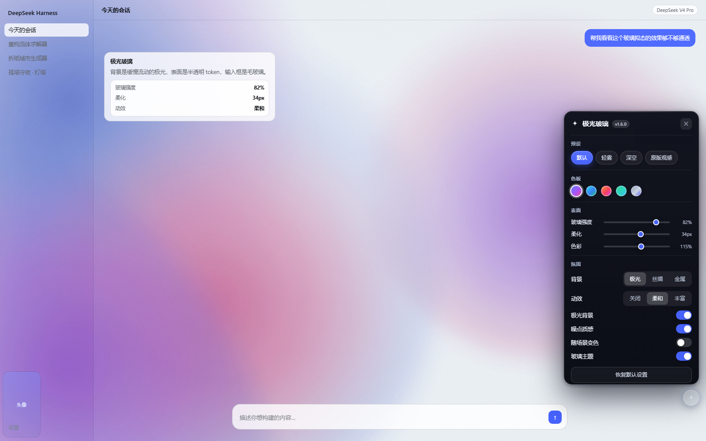
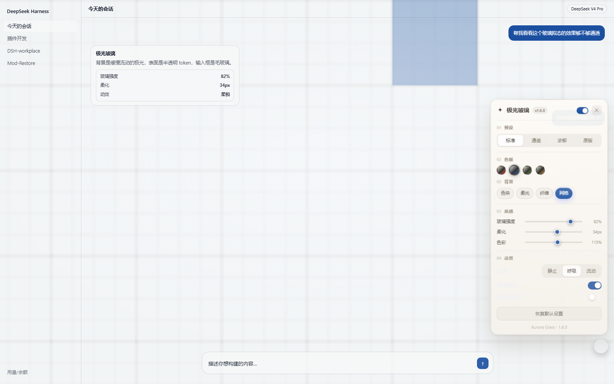

# Aurora Glass · 极光玻璃

> **`dsh-aurora-glass`** — 为 DeepSeek Harness（DSH）打造的全局玻璃拟态 + 极光渐变主题插件。
> A global glassmorphism + aurora theme plugin for DeepSeek Harness.

   

<p align="center">
  
  
  
  
  
  
  
  
  
</p>

不替换任何组件，只改 CSS token 层 —— 侧栏、对话区、输入框、代码块、弹窗会一起变；
深浅色跟随宿主自己的 `data-ds-dark-theme` 属性切换，不需要重新注入样式；
控件是挂在 `document.body` 上的独立浮层（`z-index: 2147483647`），不会被别的插件盖住。

---

## 简体中文

### 安装

插件目录以 `link:` 方式被 profile 引用。`~/.dsh/profiles/desktop/package.json`：

```json
{
  "dependencies": {
    "dsh-aurora-glass": "link:D:/DSH-work/dsh-work-1/dsh-aurora-glass"
  },
  "dsh": {
    "profile": {
      "bundles": ["...", "dsh-aurora-glass"]
    }
  }
}
```

改完执行一次 profile 安装（或在插件管理页重装该插件），然后**完全退出并重启 DSH**（托盘里也要退）。

卸载：把 `bundles` 里的 `dsh-aurora-glass` 去掉，重启即可。

### 使用

右下角有个小闪光按钮（平时半透明，鼠标移上去才显形），**按住可以拖到任意位置**，松手后记住坐标。点开是设置面板：

| 分区 | 内容 |
| --- | --- |
| 标题栏 | 版本号、**玻璃主题总开关**、关闭 |
| 预设 | 标准 / 通透 / 浓郁 / 原版（四段式，一键套参数） |
| 色板 · 背景 | 墨紫 / 石墨青 / 银红 / 混凝土 / 森林金 / 暗金 / 海军橙 / 纸本钴（悬停即可预览）+ 五种背景 |
| 质感 | 玻璃强度、柔化、色彩三个滑杆 |
| 动效 | 速度（关 / 柔和 / 丰富）、极光背景、噪点质感、随场景变色 |

每个控件都有悬停说明：鼠标停在预设、色板、滑杆或开关上，面板左侧会浮出一句话讲它做什么。

设置存在 `localStorage` 的 `dsh-aurora-glass:settings:v2`，删掉这个键即恢复默认。
"原版观感"把玻璃强度归零并关掉极光与噪点，等于临时回到原生外观。
点面板外或按 Esc 关闭。面板会根据控件位置自动向上或向左翻，拖到哪个角都能正常展开。

除了手动调，还有两个自动行为：

- **随场景变色**：会话标题算出一个稳定的色相偏移，再叠加按时段的正弦偏移——切会话、过时间，主色都会慢慢变
- **输入脉动**：焦点在输入框时背景亮一档

### 背景：七种，各有各的几何和交互

| 背景 | 语言 | 交互 |
| --- | --- | --- |
| **极光** | 四团径向渐变沿闭环漂移（纯 CSS） | 指针视差 + **跟随光标的一团柔光** + 打字脉动 + 切会话涌动 |
| **丝绸** | 七条横向缎带，磨边 + 一道白色高光 | 指针推开布面，同时带一条**跟着你走的缎面反光**；点击荡开涟漪 |
| **墨流** | 三瓣一串的墨团缓慢下沉 | 指针附近的墨会**变浓变大**（像在搅水），点击荡开涟漪，打字加速 |
| **花瓣** | 三层半透明褶皱花瓣缓慢绽放 | **鼠标就是花心**，花瓣按层朝你倾 |
| **色带** | 像素量化的横向色带 + 亮脊 | 鼠标像一枚**透镜**，把色带顶起来 |
| **概念艺术** | 三层山脊 + 漂移的雾 + 一束天光 | **鼠标就是光源**：光束、雾、山脊的**轮廓光**全部跟着走 |
| **梦核** | 粉紫渐变、发光球体、悬浮的空画框 | 光球会向你靠拢，**靠近时变亮**；画框按景深视差 |

### 色板：六组三色卡

取自参考视频里的配色卡，每组三个色（深 / 中 / 亮），深色和浅色模式各取一组：

| 色板 | 三色 |
| --- | --- |
| 墨紫 | `#141414` `#4C2A73` `#ADCF37` |
| 石墨青 | `#1F2326` `#1B2A52` `#26CDCB` |
| 银红 | `#B5B8BB` `#181617` `#C51E2A` |
| 森林金 | `#0A1A12` `#2E6B47` `#B18739` |
| 海军橙 | `#E7E1D3` `#12233A` `#E85327` |
| 纸本钴 | `#EFE8D6` `#1C4A9C` `#DA2E2B` |

所有背景共用同一套色板和 `--ag-hue`，所以换色板、换会话，背景都会跟着变。浅色模式用的是同一组颜色的**加深版**，不是靠透明度糊出来的粉彩。

### 性能

主题是常驻的，所以这里花的每一毫秒都会算在整机头上。三条约束：

1. **容器上没有 filter。** 全屏 `filter` 会让里面每一帧都在动的图层反复重新过滤——这是 v1.3 卡顿的根因。现在四团极光各自带 `filter: blur() saturate()`，图层内容恒定、只有 `transform` 在动，浏览器烘焙一次滤镜，之后全是合成器位移。
2. **滑杆写变量，不重建样式表。** 透明度写在 CSS 里（`rgb(… / calc(… * var(--ag-g)))`），拖动只改一个自定义属性，而且所有写入合并到一帧一次、只写变化的值。
3. **贵的滑杆松手才提交。** "柔化"和"色彩"会改变三个视口大小图层的滤镜，所以拖动时只更新数字，`change` 时才真正应用；"玻璃强度"实时。

额外的小动作（指针视差、面板入场、开关回弹）全部是 `transform` / `opacity`，走合成器，不触发布局和重绘。

### 工作原理（也是踩过的坑）

DSH 的客户端插件是一段**惰性 CJS**：`client.js` 只注册工厂，模块副作用在首次 import 时才执行。工厂返回的对象就是 Cordis 插件：

```js
window.__ModuleLoader__.load({
  id: 'dsh-aurora-glass',
  factory() {
    return {
      inject: [],                   // 一个服务都不依赖
      apply(ctx) { /* 注入 <style> + 往 body 挂浮层 */ },
    };
  },
});
```

三个硬约束，违反任何一条都会让**整个应用起不来**（不是本插件不生效，而是 DSH 直接弹"应用无法启动"）：

1. `inject` 写了不存在的服务 → 条目永远 `pending`（`waiting for service: xxx`）
2. `apply()` 抛异常 → 条目 `failed`
3. 模块体本身抛异常 → `import failed`

所以这一版的写法是：

- `inject: []`，一个服务都不要；UI 是原生 DOM，不需要 React、不需要插槽
- `apply()` 整体包在 try/catch 里，任何异常只打一条 warning
- 宿主半侧 `index.js` 是空的 `apply()`，没有可失败的代码

主题本身：宿主的 alias token（`--dsw-alias-bg-base`、`--dsw-alias-bg-layer-1/2/3`、`--dsw-alias-border-l1..4`、`--dsw-specific-sidebar-fill` 等）声明在 `body` 上，所以

```css
body { --dsw-alias-bg-base: rgb(11 13 22 / calc(.80 - .36 * var(--ag-g))) !important; }
body[data-ds-dark-theme] { --dsw-alias-bg-base: rgb(11 13 22 / calc(.80 - .36 * var(--ag-g))) !important; }
```

就能在不碰任何组件的前提下把整套界面改成半透明表面。透明度写成 `calc(... * var(--ag-g))`，所以拖"玻璃强度"滑杆只是改一个 CSS 变量，不用重建样式表。

极光是一个挂在 `body` 上的固定层（`#dsh-ag-bg`，`z-index:-1`）：四团径向渐变各自沿闭环路径漂移、缩放、旋转，带负延迟错峰，所以看起来是连续流动而不是来回摆动；上面依次压着暗角、scrim（保证正文对比度）和噪点。输入框走 `[class*="composerHero"] [class$="_card"]` 加 `backdrop-filter`，做真正的毛玻璃卡片。控件浮层是 `#dsh-ag-root`，`z-index: 2147483647`，固定挂在 `document.body` 上，所以不会被任何插件的浮层盖住。

两个容易踩的坑，顺手记在这里：

**`color-scheme` 必须声明。** 不写的话，原生 `<select>` 的弹出层会用白底渲染，而选项文字是暗色主题的白字——看起来就是一块白板，只剩一行被选中的蓝。所以主题里显式写了 `html{color-scheme:light}` / `html:has(body[data-ds-dark-theme]){color-scheme:dark}`。

**弹窗不能继承外壳的透明度。** 设置面板和主框架共用 `--dsw-alias-bg-base`，外壳要半透明才能看见极光，弹窗要是也半透明就没法读字。所以给 `[role="dialog"]`、`[role="alertdialog"]`、`[class*="popover"]` 这些容器单独把 `bg-base` 抬到 99%。

这个选择器必须收窄：早先写成 `[class*="modal"]`、`[class*="sheet"]` 这种模糊匹配，会把普通布局容器也变成不透明板，界面上就出现一块边界生硬的深色方块。

### 更新日志

每个版本改了什么、为什么改、踩了什么坑，都在 [CHANGELOG.md](CHANGELOG.md)。

### 故障排查

**弹"应用无法启动或已意外停止 / web boot: 1 entry did not activate"**

看 `%APPDATA%\@deepseek-ai\dsh-desktop\logs\crash-*-web-boot.log`，里面会写明哪个条目、什么状态：

- `pending (waiting for service: xxx)` → `inject` 写了不存在的服务
- `failed` → `apply()` 抛了异常
- `import failed` → 模块体有语法错误或依赖缺失

**只关掉这一个插件**（不要用错误弹窗上的"禁用第三方插件"，那会把所有第三方插件一起关掉）：

```powershell
.\tools\dsh-aurora-toggle.ps1 -Action disable   # 只禁用本插件
.\tools\dsh-aurora-toggle.ps1 -Action status    # 查看状态
.\tools\dsh-aurora-toggle.ps1 -Action enable    # 重新打开
```

脚本只往 `~/.dsh/profiles/desktop/cordis.patch.yml` 追加 `- id: dsh-aurora-glass / disabled: true`，并先备份原文件。

**改了代码不生效**：客户端 bundle 的 revision 取自文件 `mtimeMs / ctimeMs / size`，保存后重启 DSH 一定会重新取。

### 目录

```
client.js           浏览器半侧：样式生成 + 悬浮面板（唯一有逻辑的文件）
index.js            宿主半侧：空的 apply()，只为让包能作为 loader 条目存在
cordis.patch.yml    bundle patch：往配置树里插入本插件条目
tools/              只开关本插件的 PowerShell 脚本
docs/INSTALL.md     安装细节
```

### 兼容性

- DSH `0.2.1-rc.2`（Electron 44 / Chromium 140+）实测
- 依赖 API：`window.__ModuleLoader__`、`ctx.slots.register`、`ctx.effect`
- 依赖 CSS：`:has()`、`backdrop-filter`

---

## English

A zero-dependency glassmorphism + aurora theme for DeepSeek Harness.

- Restyles the whole shell by overriding the host's alias CSS tokens on `body`
  (and `body[data-ds-dark-theme]` for the dark scheme) — no component patching.
- Paints the aurora on `body::before` (`z-index:-1`) so translucent surfaces show it through.
- Registers one floating settings button into the `shell.overlay` slot.
- `inject: ['slots']` only, `apply()` fully wrapped in try/catch, and the host half
  is an empty `apply()`: a failing client entry aborts the entire web boot, so this
  plugin is written to be incapable of throwing.

Install by adding the package to a DSH profile (`link:` + `dsh.profile.bundles`),
then restart DSH. To disable only this plugin:
`tools/dsh-aurora-toggle.ps1 -Action disable`.

## License

MIT
